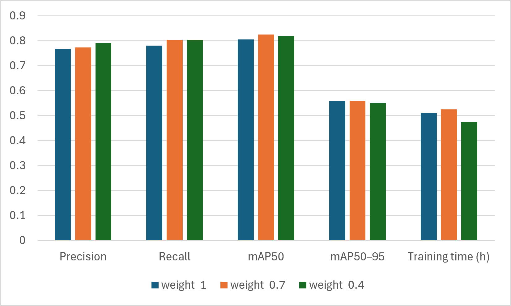

# Solar Panel ML training

## Overview

This project investigates solar-panel defect detection using YOLOv8 transfer learning object detection models. It compares two approaches to hotspot classification and evaluates the effect of class weighting on detection performance.

The experiments use thermal and RGB images and focus on three defect-related categories: solar panels, hotspots, and scratches. Method A combines all hotspots into one class, while Method B separates hotspots according to their temperature difference from the surrounding area.

## Methods

### Method A: Merged Hotspot Class

Method A uses three classes:

- `panel`
- `hotspot`
- `scratch`

All annotated hotspots are treated as a single class, regardless of their temperature difference.

### Method B: Separated Hotspot Classes

Method B uses four classes:

- `panel`
- `hotspot_obvious`
- `hotspot_doubt`
- `scratch`

The hotspot classes are defined according to the temperature difference (\(\Delta T\)):

- `hotspot_obvious`: A yellow-looking hotspot with ∆T ≥ 5◦C.
- `hotspot_doubt`: A yellow-looking hotspot with ∆T < 5◦C.

Both categories represent hotspots. The label `hotspot_doubt` does not indicate uncertainty in the annotation; it refers to a visually suspected hotspot with a temperature difference below 5◦C. Observations with ∆T ≥ 5◦C are assigned to `hotspot_obvious`.

Method B also investigates class-weighted classification loss by changing the weight assigned to `hotspot_doubt`.

## Dataset

The dataset is prepared from CVAT COCO 1.0 annotations and converted into YOLO format using `src/prepare_dataset.py`.

The preparation script supports three hotspot-labeling modes:

- **Merge:** combines obvious and doubtful hotspots into `hotspot`.
- **Split:** keeps `hotspot_obvious` and `hotspot_doubt` as separate classes.
- **Drop:** excludes doubtful-hotspot annotations while retaining the corresponding images.

Images from the same scene, including corresponding thermal (`_T`) and RGB (`_V`) images, are grouped to help prevent related images from being distributed across different dataset splits.

The dataset is not included in this repository. Access and use of the original images and annotations are subject to the applicable permissions and license.

## Dataset Split and Evaluation

A dataset of 500 images was split into training and validation subsets. An additional set of 66 unseen images was used for prediction.

| Subset | Number of images | Purpose |
|---|---:|---|
| Training | 426 | Model training |
| Validation | 74 | Validation during training |
| Unseen prediction set | 66 | Prediction and qualitative inspection |

The training and validation subsets were used for model development. The 66 unseen images were used to generate and inspect model predictions. They were not included in the training or validation subsets.


## Training Configuration

The experiments use Ultralytics YOLOv8 with the following main settings:

| Parameter | Value |
|---|---|
| Model | YOLOv8n |
| Image size | 1024 × 1024 |
| Maximum epochs | 150 |
| Batch size | 8 for the GPU experiments reported below |
| Early stopping patience | 30 epochs |
| Random seed | 0 |
| Hardware | NVIDIA GeForce RTX 3060 Laptop GPU, 6 GB VRAM |

Other augmentation and training settings are defined in `src/train.py`. Method B uses a custom weighted classification loss; the bounding-box and distribution focal loss components remain unchanged.

## Environment

The experiments were developed using the following software and hardware:

* Python 3.9.13

* PyTorch 2.8.0+cu126

* Ultralytics 8.4.95

* NVIDIA GeForce RTX 3060 Laptop GPU with 6 GB VRAM

To reproduce the experiments, install compatible versions of the required packages and ensure that PyTorch supports your GPU and CUDA environment.

## Usage

The scripts in src/ support dataset preparation, model training, and inference.

Before running the scripts, configure the dataset paths in configs/dataset_A.yaml or configs/dataset_B.yaml. The dataset is not included in this repository.

Use the following commands to inspect the available options:

```
python src/prepare_dataset.py --help
python src/train.py --help
python src/predict.py --help

```
Training and prediction require the appropriate dataset files and model checkpoints. Refer to the script arguments and configuration files for the available settings.

## Results

The reported GPU experiments used a batch size of 8 and an image size of 1024.

### Method A

| Metric | Validation result |
|---|---:|
| Precision | 0.882 |
| Recall | 0.831 |
| mAP@0.50 | 0.876 |
| mAP@0.50:0.95 | 0.614 |

### Method B: Class-Weight Comparison

| `hotspot_doubt` weight | Precision | Recall | mAP@0.50 | mAP@0.50:0.95 |
|---:|---:|---:|---:|---:|
| 1.0 | 0.769 | 0.781 | 0.806 | 0.559 |
| 0.7 | 0.774 | 0.804 | 0.825 | 0.560 |
| 0.4 | 0.791 | 0.804 | 0.819 | 0.550 |

Among these three Method B runs, the weight of 0.7 achieved the highest mAP@0.50 and mAP@0.50:0.95. The weight of 0.4 achieved the highest precision, while recall was tied with the 0.7 run at the reported precision. These results are descriptive: each setting was evaluated in a single run, so the differences should not be interpreted as statistically significant.




The overall Method A and Method B metrics are not directly comparable because the methods use different class definitions. A fair comparison requires evaluating both methods under a common hotspot taxonomy and consistent evaluation settings.

Detailed metrics (csv file), plots (F1, PR, confusion matrix,...) are provided in the `results/` directory.

## Repository Structure

```text
Solar_Panel_ML_Training/
├── README.md
├── .gitignore
├── src/
│   ├── prepare_dataset.py
│   ├── train.py
│   └── predict.py
├── configs/
│   ├── dataset_A.yaml
│   └── dataset_B.yaml
└── results/
    ├── experiment_summary.csv
    ├── metrics/
    ├── plots/
    ├── weight_comparison/
    ├── README.md
    └── predictions/ x (not obtained the necessary permissions to publish it yet)
```

The `results/` directory may contain only the files that are available and approved for publication. Trained model checkpoints and the full dataset are excluded by default.

## Author and Academic Context
This project was developed by Mohamed AGUENAROUS as part of the Master's thesis “Drone-Based Thermal Imaging System for Fault Detection through Machine Learning in Photovoltaic Plants” at the University of Genoa, Italy.

The project investigates deep-learning-based detection of photovoltaic panel defects using thermal and RGB imagery.